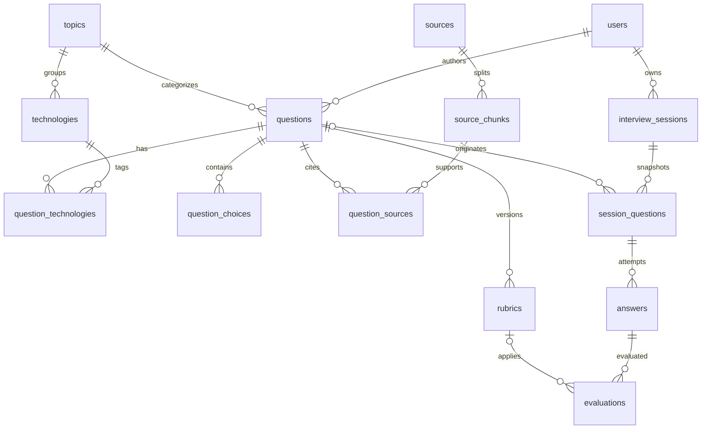

# Interview Lab — Domain model

## Kiến trúc dữ liệu

PostgreSQL là system of record. Neon cung cấp PostgreSQL serverless cho production; Drizzle quản lý schema và migration. `pgvector` chỉ được dùng cho embedding của source chunks, còn question filtering và progress vẫn dùng relational query thông thường.



## Quyết định chính

- UUID được sinh tại PostgreSQL để client không kiểm soát identifier.
- Question dùng nhiều technology qua bảng nối, nhưng có đúng một topic chính.
- Rubric và evaluation là versioned/append-only để đổi prompt hoặc model không phá lịch sử.
- Session question lưu snapshot prompt, choices và rubric; chỉnh question bank không làm thay đổi session đang chạy.
- Source và source chunk có checksum/position unique để ingestion chạy lại an toàn.
- Foreign key `restrict` bảo vệ taxonomy/source đang được tham chiếu; dữ liệu session phụ thuộc user dùng cascade.
- Vector có 1536 chiều và HNSW cosine index; migration tạo extension `vector` trước khi tạo bảng.

## Migration và seed

```bash
pnpm db:generate
pnpm db:migrate
pnpm db:seed
pnpm db:studio
```

`DATABASE_URL` chỉ nằm trong `.env.local` hoặc environment của Vercel. Test integration dùng PGlite in-memory kèm pgvector để chạy migration trên database rỗng.
