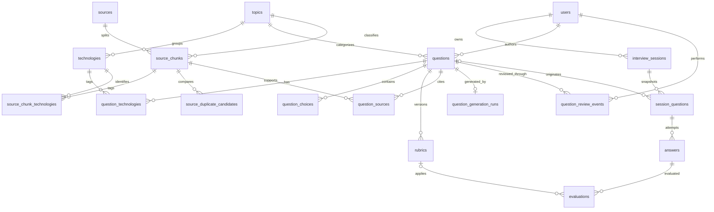

# Interview Lab — Domain model

## Kiến trúc dữ liệu

PostgreSQL là system of record. Neon cung cấp PostgreSQL serverless cho production; Drizzle quản lý schema và migration. `pgvector` chỉ được dùng cho embedding của source chunks, còn question filtering và progress vẫn dùng relational query thông thường.



## Quyết định chính

- UUID được sinh tại PostgreSQL để client không kiểm soát identifier.
- Question dùng nhiều technology qua bảng nối, nhưng có đúng một topic chính.
- Question lifecycle không hard delete; thao tác loại bỏ chuyển status sang `archived`. Cờ `is_manual` phân biệt câu do người quản trị tự biên soạn với câu phải liên kết source chunk.
- Rubric và evaluation là versioned/append-only để đổi prompt hoặc model không phá lịch sử.
- Session question lưu snapshot prompt, choices và rubric; chỉnh question bank không làm thay đổi session đang chạy.
- Source và source chunk có checksum/position unique để ingestion chạy lại an toàn.
- Foreign key `restrict` bảo vệ taxonomy/source đang được tham chiếu; dữ liệu session phụ thuộc user dùng cascade.
- Vector có 1536 chiều và HNSW cosine index; migration tạo extension `vector` trước khi tạo bảng.

## AI-assisted question generation

- Người dùng chọn từ một đến năm source chunks đã được xử lý và một loại câu hỏi; server mới tải toàn bộ nội dung nguồn để gửi cho model.
- OpenAI Responses API dùng Structured Outputs được kiểm tra bằng Zod. Schema cơ sở và invariant riêng của MCQ/tự luận đều phải hợp lệ; lỗi output được retry tối đa hai lần.
- Generated question luôn được ghi với `status = draft` và `is_manual = false`. Provider không nhận lifecycle status và không có quyền publish.
- Việc tạo question, source links, choices/rubric và `question_generation_runs` nằm trong cùng transaction. Audit lưu provider response ID, model, prompt version và token usage, không lưu lại response thô.
- Prompt coi source content là dữ liệu không tin cậy, không phải instruction; request đặt `store: false` và giới hạn tổng context nguồn.

## Question review workflow

- Review queue lấy các question ở trạng thái `draft` hoặc `reviewed`, cũ nhất trước để tránh draft bị bỏ quên.
- Approve chuyển question sang `published`; reject và merge chuyển sang `archived`; mark outdated chuyển sang `outdated`. Mọi decision cập nhật reviewer và `last_reviewed_at`.
- `question_review_events` là audit append-only, giữ action, status trước/sau, reason và canonical question khi merge.
- Reject yêu cầu reason tối thiểu 5 ký tự. Merge target phải còn hoạt động, cùng topic và đạt ngưỡng lexical similarity với source question.
- Similarity warning dùng Dice coefficient trên tập token đã Unicode-normalize. Đây là tín hiệu hỗ trợ reviewer, không tự động merge hoặc loại dữ liệu.

## Markdown ingestion

- Markdown importer chỉ đọc directory nằm trong allowlist, canonicalize file path và đăng ký SHA-256 trước khi parse.
- Một heading section tạo một `source_chunk`; breadcrumb giữ toàn bộ heading ancestry và metadata giữ line range, block counts cùng image references.
- Nội dung chunk giữ nguyên Markdown để code fence, list và image syntax không mất định dạng.
- Exact duplicate section trong cùng source được loại bằng checksum trước khi ghi, phù hợp unique constraint `(source_id, checksum)`.
- Việc thay chunks và chuyển source sang `processed` chạy trong một Neon HTTP batch transaction.
- Source đã `processed` với checksum không đổi được bỏ qua. File thay đổi được parse lại và thay thế toàn bộ chunks.
- Lỗi một file chuyển source đó sang `failed` nhưng không dừng các file còn lại trong batch.

## PDF ingestion

- PDF ingestion là local CLI workflow và gọi Poppler `pdftotext -layout -enc UTF-8`; không chạy binary trong request hoặc Vercel Function.
- Form-feed từ `pdftotext` giữ ranh giới và page number gốc. Mỗi trang có text tạo một `source_chunk`.
- Header/footer được nhận diện từ các dòng ở margin xuất hiện trên ít nhất 30% số trang có nội dung, với ngưỡng tối thiểu ba trang.
- Pure page-number lines và repeated margin lines bị loại; indentation, bullet và line break còn lại được giữ.
- Heading được suy luận từ các text block ngắn ở đầu trang. Không có tín hiệu đủ mạnh thì `heading` để `null` thay vì đoán.
- Quality score dựa trên lượng text, readable-character ratio và replacement characters; trang yếu được gắn `reviewRequired` cùng lý do.
- PDF source dùng chung checksum registry, atomic chunk replacement và per-file failure isolation với Markdown pipeline.

## Normalize, classify và deduplicate

- Taxonomy classifier deterministic chuẩn hóa technology aliases, sau đó gắn một topic chính, các technology liên quan, level và content type cho mỗi chunk.
- Classification fields nằm trực tiếp trên `source_chunks`; quan hệ nhiều-nhiều với technology nằm ở `source_chunk_technologies` để báo cáo không phụ thuộc JSON metadata.
- Embedding dùng `text-embedding-3-small` với 1536 chiều. `embedding_model` và `embedded_at` cho phép chạy lại mà không gọi API cho vector còn hợp lệ.
- Exact duplicate dùng checksum và luôn chạy trước semantic comparison. Semantic duplicate chỉ so chunk thuộc hai source khác nhau bằng cosine similarity.
- Duplicate candidate không làm mất dữ liệu. Bảng `source_duplicate_candidates` giữ similarity cùng trạng thái review `pending`, `confirmed` hoặc `dismissed`; pipeline upsert lần phát hiện mới nhưng không ghi đè quyết định của người review.

## Migration và seed

```bash
pnpm db:generate
pnpm db:migrate
pnpm db:seed
pnpm db:studio
```

`DATABASE_URL` chỉ nằm trong `.env.local` hoặc environment của Vercel. Test integration dùng PGlite in-memory kèm pgvector để chạy migration trên database rỗng.
