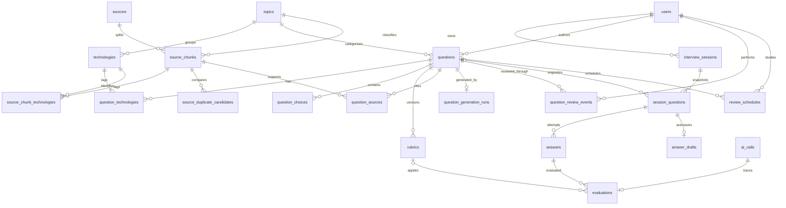

# Interview Lab — Domain model

## Kiến trúc dữ liệu

PostgreSQL là system of record. Neon cung cấp PostgreSQL serverless cho production; Drizzle quản lý schema và migration. `pgvector` chỉ được dùng cho embedding của source chunks, còn question filtering và progress vẫn dùng relational query thông thường.



## Quyết định chính

- UUID được sinh tại PostgreSQL để client không kiểm soát identifier.
- Question dùng nhiều technology qua bảng nối, nhưng có đúng một topic chính.
- Question lifecycle không hard delete; thao tác loại bỏ chuyển status sang `archived`. Cờ `is_manual` phân biệt câu do người quản trị tự biên soạn với câu phải liên kết source chunk.
- Rubric và evaluation là versioned/append-only để đổi prompt hoặc model không phá lịch sử.
- Session question lưu snapshot prompt, choices và rubric; chỉnh question bank không làm thay đổi session đang chạy.
- Source và source chunk có checksum/position unique để ingestion chạy lại an toàn.
- Foreign key `restrict` bảo vệ taxonomy/source đang được tham chiếu; dữ liệu session phụ thuộc user dùng cascade.
- Vector có 1536 chiều và HNSW cosine index; migration tạo extension `vector` trước khi tạo bảng.

## AI-assisted question generation

- Người dùng chọn từ một đến năm source chunks đã được xử lý và một loại câu hỏi; server mới tải toàn bộ nội dung nguồn để gửi cho model.
- Gemini Structured Outputs qua Vercel AI SDK được kiểm tra bằng Zod. Schema cơ sở và invariant riêng của MCQ/tự luận đều phải hợp lệ; lỗi output được retry tối đa hai lần.
- Generated question luôn được ghi với `status = draft` và `is_manual = false`. Provider không nhận lifecycle status và không có quyền publish.
- Việc tạo question, source links, choices/rubric và `question_generation_runs` nằm trong cùng transaction. Audit lưu provider response ID, model, prompt version và token usage, không lưu lại response thô.
- Prompt coi source content là dữ liệu không tin cậy, không phải instruction và giới hạn tổng context nguồn.

## Question review workflow

- Review queue lấy các question ở trạng thái `draft` hoặc `reviewed`, cũ nhất trước để tránh draft bị bỏ quên.
- Approve chuyển question sang `published`; reject và merge chuyển sang `archived`; mark outdated chuyển sang `outdated`. Mọi decision cập nhật reviewer và `last_reviewed_at`.
- `question_review_events` là audit append-only, giữ action, status trước/sau, reason và canonical question khi merge.
- Reject yêu cầu reason tối thiểu 5 ký tự. Merge target phải còn hoạt động, cùng topic và đạt ngưỡng lexical similarity với source question.
- Similarity warning dùng Dice coefficient trên tập token đã Unicode-normalize. Đây là tín hiệu hỗ trợ reviewer, không tự động merge hoặc loại dữ liệu.

## MCQ practice session

- Practice configuration chỉ query question `published` có type `mcq`; category, technology, level, count và selection strategy đều được validate lại ở server.
- Khi bắt đầu, session snapshot prompt, explanation, topic, choices đã xáo trộn, answer key và source metadata. Answer key nằm ở server DTO boundary và không được gửi trước submit.
- Session persist current position và timestamps. Mỗi mutation kiểm tra user ownership, session state, current question và choice membership; unique `(session_question_id, attempt_number)` chặn double submit.
- Chấm MCQ là deterministic server code. Result lấy score, duration và topic breakdown từ snapshot/answer rows, không gọi AI và không đọc lại nội dung question bank.
- Retry câu sai tạo session độc lập mới và lưu `retryOfSessionId`; lịch sử cũ giữ nguyên append-only.

## AI essay evaluation

- Essay session snapshot prompt, topic, source metadata và rubric version. `answer_drafts` tách khỏi submitted `answers`, nên autosave không tạo attempt giả và reload không mất nội dung.
- Mỗi submit insert answer attempt mới trước khi gọi AI. Provider failure chỉ đưa session về trạng thái `answering`; answer đã lưu có thể retry mà không nhập lại.
- Retrieval embed question rồi cosine search source chunks `processed` có cùng topic, technology và embedding model. Top-k và similarity threshold lấy từ environment.
- Vercel AI SDK gọi Gemini Structured Output qua provider abstraction. Prompt coi answer/source là untrusted data và chỉ được dùng rubric, reference cùng retrieved context.
- Server clamp từng dimension và tự tính weighted score. Khi không có evidence, `incorrect_claims` bị xóa và evaluation phải biểu thị uncertainty.
- `evaluations` append-only giữ model, prompt version, correlation/provider response IDs, source IDs, usage và feedback. `ai_calls` giữ metadata vận hành/estimated cost cho cả success/failure nhưng không lưu prompt, answer hoặc raw error.

## Adaptive mock interview

- Mock session dùng state graph server-side `setup → asking → answering/evaluating → follow_up|asking|summary`, cùng nhánh `abandoned`. Transition ngoài graph bị từ chối trước khi query database.
- Mỗi session có optimistic `version`; mutation phải khớp ownership, current state và version. Unique answer constraint cộng version lock ngăn double-submit tạo hai turn.
- `deadline_at`, `current_position` và state được persist nên refresh hoặc thiết bị khác có thể resume. State trung gian có recovery path không yêu cầu nhập lại answer.
- Câu chính chỉ lấy từ question bank `published`, snapshot rubric/source và không lặp question ID. Rule ưu tiên topic coverage cùng level trước khi Gemini được phép chọn một follow-up có giới hạn.
- Follow-up là `session_questions` có `parent_session_question_id`, `follow_up_number` và `question_id = null`; nó kế thừa rubric/source snapshot của câu gốc.
- Answer được persist trước evaluation. Gemini failure fallback sang câu bank tiếp theo; model không có quyền đổi session state, deadline, score hay question count.
- Final report chỉ aggregate latest persisted evaluation theo answer. Mọi strength/gap/incorrect claim giữ liên kết về turn và answer làm evidence.

## System-design và coding workspaces

- `system_design_problems` giữ context, functional/non-functional requirements, constraints và rubric bảy chiều. Seed tạo idempotent ba bài mẫu đã review.
- Session đi qua sáu checkpoint cố định. `system_design_checkpoint_responses` autosave Markdown; `system_design_reviews` append-only giữ feedback assumption/trade-off và score server-weighted.
- Mermaid nằm trong `design_attachments`; ảnh chỉ nhận PNG/JPEG/WebP tối đa 3 MB, lưu private Vercel Blob và metadata/ownership nằm trong PostgreSQL.
- Private image chỉ được stream qua authenticated route hoặc tải server-side thành bytes cho Gemini multimodal input. Xóa image gọi Blob `del` trước khi xóa metadata.
- Coding session snapshot published coding question/rubric. `coding_drafts` giữ language, code, explanation; `coding_reviews` giữ đúng source snapshot đã review.
- Web tier không có code runner. Mọi coding review có `execution_status = not_run`; prompt và UI cấm tuyên bố test pass hoặc code chạy đúng khi không có execution evidence.

## Learning loop

- Dashboard chỉ aggregate session ở state `completed` hoặc `summary`; session `abandoned` không đóng góp session count, duration, accuracy hay recommendation evidence.
- Weakness ranking chạy deterministic từ 55% performance gap, 25% recency risk và 20% rubric gap. Mỗi recommendation giữ evidence, sample size và confidence; dưới ba mẫu luôn được ghi `low`.
- Gemini nhận ranking đã cố định và chỉ tạo narrative/action text. Model không ghi đè score, evidence hoặc thứ tự topic.
- `review_schedules` có unique `(user_id, question_id)` và giữ ease, interval, repetitions, due time, kết quả cùng confidence gần nhất. Mỗi MCQ submit cập nhật lịch theo biến thể SM-2 có ease floor 1.3.
- Daily queue sort `due_at` tăng dần trước, sau đó mới bổ sung published MCQ chưa có schedule. Reset xóa riêng schedule của user; lịch sử answer không bị xóa.

## Production hardening

- `ai_calls` chỉ giữ operational metadata, token, cost estimate và correlation ID; không lưu prompt, answer hay raw provider response. `/ops` aggregate theo feature/model và cảnh báo dựa trên environment threshold.
- Provider enforce hard limit riêng cho từng AI operation trước network I/O. Source, candidate text, code và diagram text luôn được đặt dưới instruction coi là untrusted data; output tiếp tục qua Zod schema.
- Secret scan và offline golden regression là quality gate. Live eval dùng cùng dataset Frontend, Backend, DevOps, System Design và fail khi score lệch baseline vượt tolerance.
- Privacy export chỉ trả dữ liệu thuộc authenticated user và loại private Blob locator. Delete xóa Blob trước, sau đó xóa audit event cần thiết và user để database cascade session/draft/answer/evaluation/schedule.
- Security headers áp dụng toàn site. Server Actions vẫn authenticate bên trong action; private route handler kiểm tra auth và ownership trước khi đọc dữ liệu.

## Markdown ingestion

- Markdown importer chỉ đọc directory nằm trong allowlist, canonicalize file path và đăng ký SHA-256 trước khi parse.
- Một heading section tạo một `source_chunk`; breadcrumb giữ toàn bộ heading ancestry và metadata giữ line range, block counts cùng image references.
- Nội dung chunk giữ nguyên Markdown để code fence, list và image syntax không mất định dạng.
- Exact duplicate section trong cùng source được loại bằng checksum trước khi ghi, phù hợp unique constraint `(source_id, checksum)`.
- Việc thay chunks và chuyển source sang `processed` chạy trong một Neon HTTP batch transaction.
- Source đã `processed` với checksum không đổi được bỏ qua. File thay đổi được parse lại và thay thế toàn bộ chunks.
- Lỗi một file chuyển source đó sang `failed` nhưng không dừng các file còn lại trong batch.

## PDF ingestion

- PDF ingestion là local CLI workflow và gọi Poppler `pdftotext -layout -enc UTF-8`; không chạy binary trong request hoặc Vercel Function.
- Form-feed từ `pdftotext` giữ ranh giới và page number gốc. Mỗi trang có text tạo một `source_chunk`.
- Header/footer được nhận diện từ các dòng ở margin xuất hiện trên ít nhất 30% số trang có nội dung, với ngưỡng tối thiểu ba trang.
- Pure page-number lines và repeated margin lines bị loại; indentation, bullet và line break còn lại được giữ.
- Heading được suy luận từ các text block ngắn ở đầu trang. Không có tín hiệu đủ mạnh thì `heading` để `null` thay vì đoán.
- Quality score dựa trên lượng text, readable-character ratio và replacement characters; trang yếu được gắn `reviewRequired` cùng lý do.
- PDF source dùng chung checksum registry, atomic chunk replacement và per-file failure isolation với Markdown pipeline.

## Normalize, classify và deduplicate

- Taxonomy classifier deterministic chuẩn hóa technology aliases, sau đó gắn một topic chính, các technology liên quan, level và content type cho mỗi chunk.
- Classification fields nằm trực tiếp trên `source_chunks`; quan hệ nhiều-nhiều với technology nằm ở `source_chunk_technologies` để báo cáo không phụ thuộc JSON metadata.
- Embedding dùng `gemini-embedding-2` với output 1536 chiều. Document dùng `title: … | text: …`, retrieval query dùng `task: question answering | query: …`. `embedding_model` và `embedded_at` buộc re-embed khi đổi model nhưng bỏ qua vector Gemini còn hợp lệ.
- Exact duplicate dùng checksum và luôn chạy trước semantic comparison. Semantic duplicate chỉ so chunk thuộc hai source khác nhau bằng cosine similarity.
- Duplicate candidate không làm mất dữ liệu. Bảng `source_duplicate_candidates` giữ similarity cùng trạng thái review `pending`, `confirmed` hoặc `dismissed`; pipeline upsert lần phát hiện mới nhưng không ghi đè quyết định của người review.

## Migration và seed

```bash
pnpm db:generate
pnpm db:migrate
pnpm db:seed
pnpm db:studio
```

Seed mặc định là idempotent và bao gồm taxonomy, 608 câu hỏi: bộ fullstack web, 271 MCQ Fresher fullstack, 60 câu trọng tâm `Java–MySQL Exam` và 34 câu `Java–MySQL Extended`, cùng ba system-design templates đã review. Câu hỏi dùng deterministic ID để có thể cập nhật content pack mà không nhân bản dữ liệu.

`DATABASE_URL` chỉ nằm trong `.env.local` hoặc environment của Vercel. Test integration dùng PGlite in-memory kèm pgvector để chạy migration trên database rỗng.
